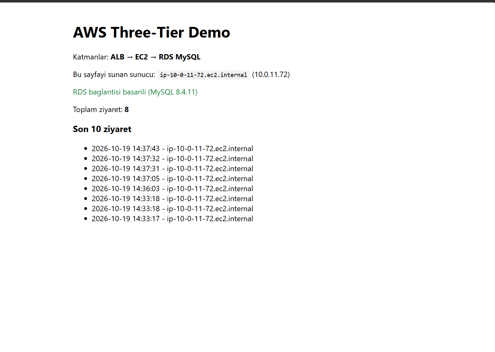
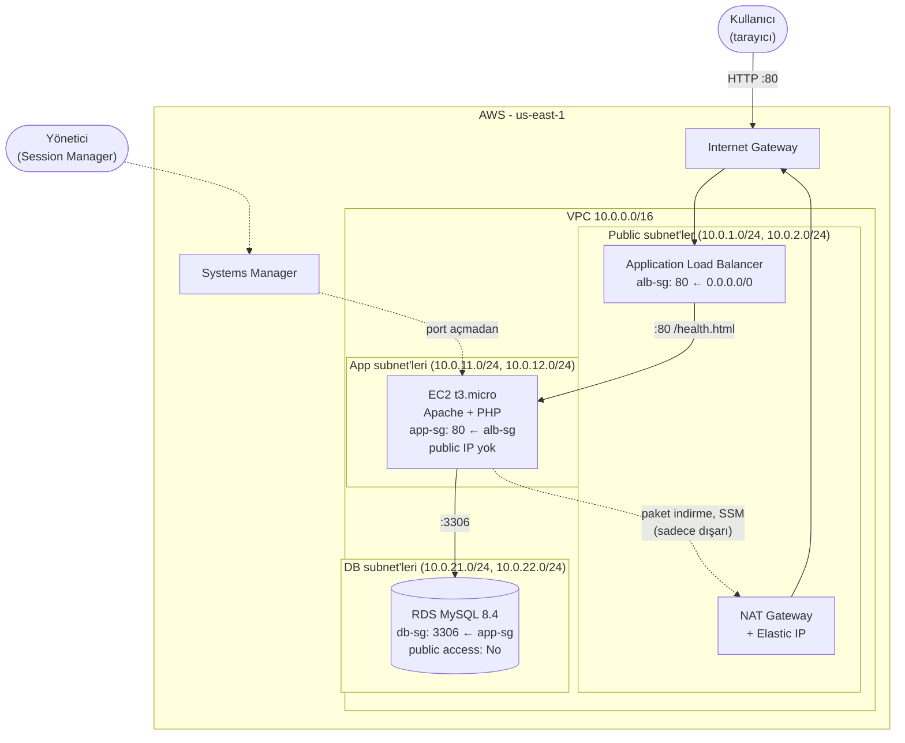

# AWS Three-Tier Mimari: ALB → EC2 → RDS

Bu proje, AWS üzerinde klasik **üç katmanlı (three-tier)** bir web mimarisinin sıfırdan, varsayılan ayarlar kullanılmadan kurulmasını kapsar. Kendi VPC'si, katman başına ayrı subnet'leri, birbirine zincirlenmiş security group'ları, private subnet'te çalışan uygulama sunucusu ve dışarıya tamamen kapalı bir veritabanı içerir.

Bir önceki proje ([AWS Lift & Shift](https://github.com/SenaOz-DevOps-Lab/AWS_LiftShift)) uygulamayı olduğu gibi tek bir EC2 sunucusuna taşıyordu. Bu proje ise aynı soruya bulutun kendi yapı taşlarıyla cevap verir: yük dengeleyici, yönetilen veritabanı, ağ izolasyonu ve anahtarsız sunucu erişimi.



*ALB üzerinden açılan sayfa. İsteği karşılayan EC2 sunucusunun adı, RDS bağlantı durumu ve RDS'e yazılıp geri okunan ziyaret kayıtları görünüyor.*

---

## İçindekiler

1. [Proje Yol Haritası](#1-proje-yol-haritası)
2. [Mimari](#2-mimari)
3. [Ağ Tasarımı](#3-ağ-tasarımı)
4. [Kurulum Adımları ve Kararlar](#4-kurulum-adımları-ve-kararlar)
5. [Uygulama](#5-uygulama)
6. [Testler ve Doğrulama](#6-testler-ve-doğrulama)
7. [Karşılaşılan Sorunlar ve Çözümleri](#7-karşılaşılan-sorunlar-ve-çözümleri)
8. [Maliyet](#8-maliyet)
9. [Kaynakların Temizlenmesi](#9-kaynakların-temizlenmesi)
10. [Kullanılan Teknolojiler](#10-kullanılan-teknolojiler)
11. [Proje 13 ile Karşılaştırma](#11-proje-13-ile-karşılaştırma)
12. [Geliştirilebilecek Noktalar](#12-geliştirilebilecek-noktalar)

---

## 1. Proje Yol Haritası

| Seviye | Kapsam | Durum |
|---|---|---|
| 🟢 | ALB → EC2 → RDS mimarisini elle kurmak | Tamamlandı |
| 🟡 | Auto Scaling Group eklemek, health check yapılandırmak | Planlandı |
| 🔴 | Route53 ile domain, ACM ile HTTPS, çoklu AZ'de yüksek erişilebilirlik | Planlandı |

🟢 seviyesi kurulurken 🟡 ve 🔴 seviyeleri için gereken altyapı da baştan hazırlandı: iki AZ'ye yayılmış subnet'ler, IP yerine security group referansı kullanan kurallar ve iki AZ'li DB subnet group.

---

## 2. Mimari



| Katman | Servis | İnternetten erişilebilir mi? | Kim erişebilir? |
|---|---|---|---|
| Sunum | Application Load Balancer | Evet, tek giriş kapısı | Herkes, port 80 |
| Uygulama | EC2 (Amazon Linux 2023, Apache, PHP) | Hayır | Sadece ALB, port 80 |
| Veri | RDS for MySQL | Hayır | Sadece uygulama sunucuları, port 3306 |

**Neden üç katman?**

- **Güvenlik:** İnternetten yalnızca ALB görünür. Veritabanına giden doğrudan bir yol yoktur. Bir saldırganın veriye ulaşması için önce ALB'yi, sonra uygulama sunucusunu aşması gerekir.
- **Ölçeklenebilirlik:** Trafik arttığında yalnızca uygulama katmanı büyütülür. ALB ve RDS'e dokunulmaz.
- **Bağımsız bakım:** Her katman ayrı yönetilir. Veritabanı yedeklemesi veya sunucu yenilemesi diğer katmanları etkilemez.

---

## 3. Ağ Tasarımı

### 3.1 Subnet planı

| Subnet | AZ | CIDR | Katman | İçindekiler |
|---|---|---|---|---|
| public-a | us-east-1a | 10.0.1.0/24 | Sunum | ALB düğümü, NAT Gateway |
| public-b | us-east-1b | 10.0.2.0/24 | Sunum | ALB düğümü |
| app-a | us-east-1a | 10.0.11.0/24 | Uygulama | EC2 |
| app-b | us-east-1b | 10.0.12.0/24 | Uygulama | (🟡'de ikinci EC2) |
| db-a | us-east-1a | 10.0.21.0/24 | Veri | RDS subnet group |
| db-b | us-east-1b | 10.0.22.0/24 | Veri | RDS subnet group |

- **Numaralandırma:** Üçüncü oktet katmanı (1-2 public, 11-12 app, 21-22 db), son rakam AZ'yi (1 → a, 2 → b) gösterir. Loglarda bir IP görüldüğünde hangi katman ve AZ'den geldiği hemen anlaşılır.
- **Neden 🟢 seviyesinde bile iki AZ:** ALB en az iki AZ'de subnet ister. RDS subnet group da en az iki AZ zorunlu tutar.
- **Kullanılabilir IP:** Her /24 subnet'te 256 değil 251 adres kullanılabilir. AWS `.0`, `.1` (router), `.2` (DNS), `.3` (rezerve) ve `.255` adreslerini ayırır.
- Hiçbir subnet'te "auto-assign public IPv4" açılmadı.

### 3.2 Route table'lar

| Route table | Rotalar | Bağlı subnet'ler | Sonuç |
|---|---|---|---|
| public-rt | `10.0.0.0/16 → local`, `0.0.0.0/0 → IGW` | public-a, public-b | İnternete açık |
| app-rt | `10.0.0.0/16 → local`, `0.0.0.0/0 → NAT` | app-a, app-b | Sadece dışarı çıkabilir |
| db-rt | `10.0.0.0/16 → local` | db-a, db-b | İnternetle hiçbir bağlantısı yok |
| main (otomatik) | `10.0.0.0/16 → local` | Hiçbiri | Bilinçli olarak kullanılmadı |

- Bir subnet'i **public** yapan şey adı değil, route table'ındaki `0.0.0.0/0 → Internet Gateway` satırıdır.
- **Longest prefix match:** VPC içi bir adres hem `10.0.0.0/16` hem `0.0.0.0/0` satırına uyar. Daha spesifik olan `/16` (local) seçilir, bu yüzden iç trafik hiçbir zaman internete çıkmaz.
- **Ana route table kullanılmadı:** Açıkça bir tabloya bağlanmamış her subnet ana tabloyu kullanır. Ana tabloya ileride eklenecek tek bir `0.0.0.0/0 → IGW` satırı veritabanı subnet'lerini de internete açabilirdi. Her katman kendi tablosuna açıkça bağlanarak bir hatanın etki alanı (blast radius) sınırlandı.

### 3.3 Security group zinciri

```
İnternet ──:80──► alb-sg ──:80──► app-sg ──:3306──► db-sg
```

| Security group | Inbound | Kaynak |
|---|---|---|
| alb-sg | TCP 80 | `0.0.0.0/0` |
| app-sg | TCP 80 | **alb-sg** |
| db-sg | TCP 3306 | **app-sg** |

- **Kaynak olarak IP değil SG kullanıldı.** Auto Scaling'in açacağı yeni sunucuların IP'leri önceden bilinmez. Kural "app-sg'ye üye olan herkes" dediği için yeni sunucular kurala otomatik dahil olur.
- **SSH (22) hiçbir yerde açık değil.** Sunuculara Session Manager ile bağlanılıyor.
- **443 henüz açılmadı.** HTTPS 🔴 seviyesinde ACM sertifikasıyla eklenecek. Sadece gereken port açıldı.
- Route table "yol var mı?", security group "kapı açık mı?" sorusunu cevaplar. Örneğin ALB'nin `local` route'u sayesinde RDS'e giden bir yolu vardır, ama db-sg kapısı ona kapalıdır.

---

## 4. Kurulum Adımları ve Kararlar

Adım 1-3 AWS Console üzerinden, adım 4-8 AWS CLI ile yapıldı. Tüm işlemler root yerine MFA korumalı bir IAM kullanıcısıyla (`Admins` grubu) gerçekleştirildi. CLI oturumu, kalıcı access key yerine `aws login` ile alınan geçici kimlik bilgileriyle açıldı.

| Adım | Kaynak | Önemli kararlar |
|---|---|---|
| 1 | VPC `10.0.0.0/16` | Default VPC kullanılmadı. DNS resolution ve DNS hostnames açıldı (RDS'e endpoint ismiyle bağlanmak için) |
| 2 | 6 subnet | 3 katman × 2 AZ |
| 3 | Internet Gateway, 3 route table | **NAT Gateway bilinçli olarak 7. adıma ertelendi** (maliyet) |
| 4 | 3 security group | SG referanslı zincir, SSH yok |
| 5 | IAM rolü `ec2-ssm-role` | Sadece `AmazonSSMManagedInstanceCore`. Geniş yetkili `AmazonSSMFullAccess` kullanılmadı |
| 6 | RDS subnet group + RDS MySQL | `db.t4g.micro`, gp3 20 GB, Single-AZ, **public access: No**, ilk veritabanı `appdb`, günlük otomatik yedek |
| 7 | NAT Gateway + EIP, EC2 | NAT `public-a`'da, `app-rt`'ye route eklendi. EC2 public IP'siz, IMDSv2 zorunlu, user-data ile kuruldu |
| 8 | Target group, ALB, listener | Health check `/health.html`, 10 sn aralık, 2 başarılı kontrolde healthy |

### Öne çıkan kararlar

**NAT Gateway'in ertelenmesi.** NAT Gateway projenin en pahalı kalemi (saatte ~$0.045 + Elastic IP için saatte $0.005). Ona ihtiyaç duyan tek bileşen uygulama sunucusu (paket kurulumu ve SSM bağlantısı için). Security group, IAM ve RDS adımları NAT kullanmadığı için NAT, EC2'nin hemen öncesinde oluşturuldu.

**SSH yerine Session Manager.** EC2'nin public IP'si yok ve hiçbir inbound portu SSH için açık değil. SSM Agent, NAT üzerinden AWS'ye kendisi bağlanır. Yönetici o bağlantının içinden komut çalıştırır. Key dosyası yönetimi ve port 22'ye yönelik tarama saldırıları ortadan kalkar.

**IAM rolü ve instance profile.** Konsol, rol oluştururken aynı isimde bir instance profile'ı otomatik yaratır. CLI ile kurulumda bu, `create-instance-profile` ve `add-role-to-instance-profile` adımlarıyla ayrıca yapıldı. Rol, EC2'ye doğrudan değil bu kap aracılığıyla takılır.

**IMDSv2 zorunluluğu.** EC2 metadata servisine yalnızca token ile erişilebilir (`HttpTokens=required`). Bu, SSRF tipi saldırılarla instance kimlik bilgilerinin çalınmasını zorlaştırır.

**Statik health check.** ALB, uygulamanın ana sayfasını değil, veritabanına bağlı olmayan statik bir `/health.html` dosyasını kontrol eder (shallow health check). Veritabanında anlık bir sorun olduğunda sağlam sunucular "hasta" sayılıp devreden çıkarılmaz.

**Şifre yönetimi.** Veritabanı şifresi rastgele üretildi ve repo dışında geçici bir dosyada tutuldu. Repodaki `user-data.sh` yalnızca yer tutucu (`__DB_HOST__`, `__DB_PASS__`) içerir, gerçek değerler kurulum anında `sed` ile dolduruldu. Proje silindikten sonra geçici dosyalar da silindi.

---

## 5. Uygulama

Uygulama bilinçli olarak basit tutuldu: tek sayfalık bir PHP betiği. Projenin konusu altyapı. Basit bir uygulamayla bir hata görüldüğünde sorunun ağda mı uygulamada mı olduğu hızla ayırt edilebilir. Ayrıca Java tabanlı bir uygulamanın aksine t3.micro'ya sığar ve bir dakikada ayağa kalkar. Bu, 🟡 seviyesindeki Auto Scaling için önemli.

[`user-data.sh`](user-data.sh) EC2 ilk açıldığında çalışır:

1. `httpd`, `php`, `php-mysqlnd` ve `mariadb105` (test için mysql istemcisi) paketlerini kurar.
2. DB bilgilerini **web kökünün dışındaki** `/var/www/config.php` dosyasına yazar. Dosya izni `640`, sahibi `root:apache`.
3. ALB health check'i için statik `/var/www/html/health.html` dosyasını oluşturur.
4. `index.php`'yi oluşturur. Sayfa her açıldığında:
   - isteği karşılayan sunucunun adını gösterir (`gethostname()`)
   - RDS'e bağlanır, `ziyaretler` tablosunu yoksa oluşturur
   - **prepared statement** ile yeni bir kayıt ekler (SQL injection'a karşı)
   - son 10 kaydı `htmlspecialchars()` ile kaçırarak listeler (XSS'e karşı)

Betikte iki farklı heredoc kullanılır:
- `<<EOF` (tırnaksız): bash, `$DB_HOST` gibi değişkenleri doldurur. PHP değişkenleri `\$` ile korunur.
- `<<'EOF'` (tırnaklı): PHP kodu hiçbir değişiklik yapılmadan olduğu gibi yazılır.

---

## 6. Testler ve Doğrulama

| Test | Yöntem | Sonuç | Kanıtladığı şey |
|---|---|---|---|
| Uçtan uca istek | ALB DNS adına art arda 3 istek | 200, ziyaret sayısı 1 → 2 → 3 | ALB → EC2 → RDS zinciri yazma ve okuma yapıyor |
| Health check | `/health.html` | 200, target `healthy` | ALB sunucuyu sağlıklı görüyor |
| Gizli dosya | `/config.php` | 404 | DB bilgileri web'den okunamıyor |
| EC2'nin izolasyonu | EC2'nin private IP'sine dışarıdan istek | Ulaşılamadı | EC2 gerçekten private |
| NAT çıkışı | SSM ile EC2 içinden `curl checkip.amazonaws.com` | NAT'ın Elastic IP'si döndü | Private sunucu dışarıya NAT üzerinden çıkıyor |
| DB erişimi | SSM ile EC2 içinden `mysql ... SELECT` | Kayıtlar listelendi | db-sg zinciri doğru çalışıyor |
| Session Manager | `aws ssm describe-instance-information` | `Online` | Port açmadan sunucu yönetimi mümkün |

Komutlar EC2'nin içinde `aws ssm send-command` (`AWS-RunShellScript` dokümanı) ile çalıştırıldı. Bu yöntem SSH veya ek bir eklenti gerektirmez.

---

## 7. Karşılaşılan Sorunlar ve Çözümleri

### Sorun 1: IAM kullanıcısıyla giriş yapılamaması

- **Belirti:** Yeni IAM kullanıcısıyla girişte `Authentication failed`.
- **Neden:** "Account ID or alias" alanına kullanıcı adı, "IAM username" alanına root e-posta adresi yazılmıştı. Tarayıcının otomatik doldurma özelliği alanları root bilgileriyle doldurmuştu.
- **Çözüm:** Hesap alanına hesap takma adı, kullanıcı alanına IAM kullanıcı adı yazıldı ve şifre elle girildi.
- **Öğrenilen:** Root kullanıcı e-posta adresiyle, IAM kullanıcıları ise hesap kimliği veya takma adı ile birlikte kullanıcı adıyla giriş yapar. Hesap takma adı ile kullanıcı adı farklı şeylerdir.

### Sorun 2: `Unable to load paramfile file:///tmp/...`

- **Belirti:** IAM rolünün trust policy'si `file://` ile verildiğinde dosya bulunamadı.
- **Neden:** JSON dosyası Git Bash'in `/tmp` klasörüne yazılmıştı. Windows'ta çalışan `aws.exe`, Git Bash'in Linux tarzı sanal yollarını tanımaz.
- **Çözüm:** JSON, dosya yerine komutun içinde tek tırnaklar arasında verildi.
- **Öğrenilen:** Git Bash'te `file://` ile Windows yolu (`file://C:/...`) veya göreli yol kullanılmalı.

### Sorun 3: `ParameterNotFound` (AMI parametresi)

- **Belirti:** `aws ssm get-parameter --name /aws/service/ami-amazon-linux-latest/...` parametreyi bulamadı. Sonraki `run-instances` komutu `--image-id: expected one argument` hatası verdi.
- **Neden:** Git Bash (MSYS), `/` ile başlayan argümanları otomatik olarak Windows yoluna çevirir. Parametre adı `C:/Program Files/Git/aws/service/...` şekline dönüştü.
- **Çözüm:** Komutun başına `MSYS_NO_PATHCONV=1` eklendi. Aynı önlem `--health-check-path /health.html` parametresinde de alındı.
- **Öğrenilen:** Git Bash'te `/` ile başlayan AWS argümanlarında path conversion kapatılmalı. Değişkene atanan değerin boş gelmesi bir sonraki komutta yanıltıcı bir hataya yol açar. Değişkenler kullanılmadan önce kontrol edilmeli.

### Sorun 4: `'charmap' codec can't encode character`

- **Belirti:** SSM komut çıktısı okunurken `'charmap' codec can't encode character '\u2192'` hatası alındı.
- **Neden:** Windows konsolunun varsayılan kodlaması UTF-8 karakterleri (`→`) yazdıramaz.
- **Çözüm:** `export PYTHONIOENCODING=utf-8 PYTHONUTF8=1`
- **Öğrenilen:** Windows'ta AWS CLI çıktısında Türkçe veya özel karakter olabilecekse UTF-8 zorlanmalı.

### Not: Security group açıklamaları

Security group açıklama alanı yalnızca ASCII karakterleri kabul eder. Türkçe karakter (`ı, ş, ğ, ü, ö, ç`) kullanıldığında `Invalid character` hatası alınır. Açıklamalar İngilizce yazıldı.

---

## 8. Maliyet

| Kaynak | Ücret | Not |
|---|---|---|
| VPC, subnet, route table, IGW, security group, IAM | Ücretsiz | |
| NAT Gateway | ~$0.045/saat + veri | En pahalı kalem, en son açılıp ilk silindi |
| Elastic IP (NAT) | $0.005/saat | |
| Application Load Balancer | ~$0.0225/saat + LCU | |
| EC2 t3.micro | Free tier | |
| RDS db.t4g.micro, 20 GB gp3, Single-AZ | Free tier | Multi-AZ maliyeti iki katına çıkarır |

Ücretli kaynaklar yaklaşık 20 dakika açık kaldı. Konsolda gösterilen tutarlara KDV dahil değildir.

---

## 9. Kaynakların Temizlenmesi

AWS'de bir kaynak, ona bağlı başka bir kaynak varken silinemez. Bu yüzden silme işlemi kurulumun tersi sırasıyla yapıldı:

1. ALB (listener'ı ile birlikte silinir), EC2, RDS (`--skip-final-snapshot --delete-automated-backups`) ve NAT Gateway: birbirine bağımlı olmadıkları için aynı anda silindi
2. Target group (ALB silindikten sonra)
3. Elastic IP (NAT silindikten sonra) ve `app-rt`'deki NAT route'u
4. IAM rolü: önce instance profile'dan çıkarıldı, instance profile silindi, politika ayrıldı, rol silindi
5. DB subnet group (RDS silindikten sonra)
6. VPC'de kalan ağ arayüzü (ENI) olmadığı kontrol edildi
7. Security group'lar: referans sırasına göre `db-sg` → `app-sg` → `alb-sg`
8. Route table'lar (önce subnet ilişkilendirmeleri kaldırıldı)
9. Subnet'ler
10. Internet Gateway (önce VPC'den ayrıldı)
11. VPC (ana route table, default security group ve default NACL onunla birlikte silinir)

Son kontrolde hesapta yalnızca default VPC kaldığı, çalışan EC2, RDS, snapshot, ALB, NAT, Elastic IP ve EBS volume bulunmadığı doğrulandı. Hesap düzeyindeki bütçe ve fatura alarmı bilinçli olarak korundu.

---

## 10. Kullanılan Teknolojiler

| Alan | Araç / Servis |
|---|---|
| Ağ | Amazon VPC, subnet, route table, Internet Gateway, NAT Gateway, Elastic IP, security group |
| Hesaplama | Amazon EC2 (Amazon Linux 2023, t3.micro), user data |
| Yük dengeleme | Elastic Load Balancing: Application Load Balancer, target group, listener |
| Veritabanı | Amazon RDS for MySQL 8.4 |
| Kimlik ve erişim | IAM (kullanıcı, grup, rol, instance profile), MFA, IMDSv2 |
| Sunucu yönetimi | AWS Systems Manager: Session Manager, Run Command, Parameter Store (AMI ID) |
| Uygulama | Apache httpd, PHP 8, mysqli |
| Araçlar | AWS Console, AWS CLI v2, Git Bash, VS Code, Git ve GitHub |

---

## 11. Proje 13 ile Karşılaştırma

| Konu | Proje 13 (Lift & Shift) | Proje 14 (Three-Tier) |
|---|---|---|
| Ağ | Default VPC, public subnet | Kendi VPC'si, public / app / db subnet'leri |
| Sunucu erişimi | SSH (port 22) + `.pem` anahtarı | Session Manager, açık port yok |
| Sunucu IP'si | Public, Elastic IP | Yalnızca private IP |
| Veritabanı | Uygulamayla aynı sunucuda, Docker konteyneri | Ayrı katmanda, yönetilen RDS |
| Yedekleme | Elle yazılmış `mysqldump` betiği + cron | RDS otomatik yedekleme |
| Tek hata noktası | Tek sunucu çökerse site kapanır | ALB arkasında, 🟡'de çoklu sunucuya hazır |
| Kimlik | Root ile CLI oturumu | MFA'lı IAM kullanıcısı, geçici kimlik bilgileri |

---

## 12. Geliştirilebilecek Noktalar

| Konu | Mevcut durum | İyileştirme |
|---|---|---|
| Ölçeklenme | Tek EC2 | 🟡: Launch template + Auto Scaling Group (iki AZ, CPU'ya göre target tracking) |
| HTTPS ve domain | HTTP, ALB DNS adı | 🔴: ACM sertifikası, 443 listener, 80 → 443 yönlendirme, Route53 alias kaydı |
| Veritabanı erişilebilirliği | Single-AZ RDS | 🔴: Multi-AZ, failover testi |
| NAT erişilebilirliği | Tek AZ'de tek NAT Gateway | Her AZ'ye bir NAT (maliyet karşılığında AZ bağımsızlığı) |
| Gizli bilgiler | DB şifresi user data üzerinden config dosyasına yazılıyor | AWS Secrets Manager + rol tabanlı okuma veya RDS'in yönetilen master şifresi |
| Çıkış kuralları | Security group'larda outbound "all traffic" | Outbound'u da katmanlara göre kısıtlamak |
| NAT bağımlılığı | SSM ve paket indirme NAT üzerinden | SSM ve S3 için VPC endpoint'leri |
| Altyapı kodu | Console ve CLI | Terraform ile tekrar üretilebilir altyapı |
| İzleme | Yok | ALB 5xx, target health ve RDS CPU için CloudWatch alarmları |

---

## Klasör Yapısı

```
.
├── README.md               # Bu doküman
├── user-data.sh            # EC2 açılış betiği (DB bilgileri yer tutucu)
└── screenshots/
    └── 01-app-page.png     # ALB üzerinden açılan uygulama sayfası
```
